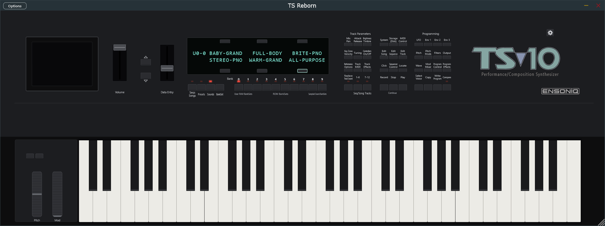

# Ensoniq TS Reborn

This emulator was creating by Anthony C. Bartman (@rommix0) with the assistance of Claude Opus 5.5. If you find any issues, please leave an issue or do a pull request.

An emulator of the Ensoniq TS-10 (1993), the Performance/Composition Synthesizer. The TS-12 is out of scope. It runs the instrument's own operating system, OS v3.10, from your ROM files on an emulated machine: a 68000-class CPU, the ES5506 OTTO wave chip, the ES5510 ESP effects chip and the 68681 DUART. Every screen, sound and effect comes from the original firmware, unmodified, played from a MIDI keyboard in a Standalone app or a VST3 instrument named "TS Reborn". It follows the method of [KS-32 Reborn](https://github.com/rommix0/ensoniq-ks32-reborn).

**Status:** version 1.0.0. The TS-10 machine runs the unmodified OS v3.10 in a Standalone app and a VST3 instrument, "TS Reborn", with the front panel drawn and playable (Windows x64 and Linux x64; see [docs/tsapp.md](docs/tsapp.md), named `APP-GUIDE.md` in a release folder).

The floppy drive works: the OS reads and writes disk images (raw `.img`, `.gkh`, Giebler `.ede`/`.eda`) of its own and of the ASR-10 and EPS families, from the drive on the panel or `tsemu --disk`. The SP-4 SCSI board adds a CD-ROM drive at ID 4 (`.iso` or `.cue` images, read-only, in the app and `tsemu --cd`). VST3 projects keep the sampled sounds loaded from a floppy or a CD. `tsemu` boots the machine headless, renders a MIDI file to WAV and measures its speed.

The checks only a person can do (sound, the panel, the drives, a DAW) were done by the user for Plans 4 and 5 on 2026-11-15 and for Plan 7 on 2026-11-16 ([docs/verification-plan7.md](docs/verification-plan7.md)). The release scripts build a ready-to-use folder (below). The design is [docs/design/2026-11-13-ts-emulator-design.md](docs/design/2026-11-13-ts-emulator-design.md).

## The release folder

`tools\dist.ps1` (Windows) and `tools/dist.sh` (Linux) build TS Reborn and write `dist/TS Reborn-1.0.0` (Linux: `-linux`): the program, the `TS Reborn.vst3` package, this README with its panel picture, the license, the app guide, and the six ROMs, beside the program and inside the VST3 package.

On Windows it needs nothing installed: run the program, or copy `TS Reborn.vst3` to `C:\Program Files\Common Files\VST3`, and it finds its ROMs.

The Linux folder (built on Ubuntu 24.04) needs glibc 2.38 or later (Ubuntu 24.04, Debian 13, Fedora 39 and newer) and the ALSA, fontconfig and freetype libraries a desktop system has; copy `TS Reborn.vst3` to `~/.vst3`.

A release folder holds Ensoniq's ROMs (below).

## The ROMs

The ROMs are Ensoniq's copyrighted firmware and samples. The emulator needs six files, which the release folder includes (see [roms/README.txt](roms/README.txt)):

| File                                           | Size      | What it is                           |
| ---------------------------------------------- | --------- | ------------------------------------ |
| `os/ts10_310h.bin`                             | 256 KB    | OS v3.10, high byte (even addresses) |
| `os/ts10_310l.bin`                             | 512 KB    | OS v3.10, low byte (odd addresses)   |
| `waves/901401_u41.bin`, `waves/901402_u45.bin` | 2 MB each | Wave ROMs                            |
| `waves/901301_u43.bin`, `waves/901302_u46.bin` | 1 MB each | Wave ROMs                            |

## Building

Needs CMake 3.20 or later and either Visual Studio 2022 (MSVC x64) or MinGW-w64 with Ninja.

```powershell
cmake -S . -B build-msvc -G "Visual Studio 17 2022" -A x64
cmake --build build-msvc --config Release
ctest --test-dir build-msvc -C Release --output-on-failure
```

## License

Copyright (C) 2026 Anthony C. Bartman (@rommix0)

This program is free software: you can redistribute it and/or modify it under the terms of the GNU Affero General Public License as published by the Free Software Foundation, either version 3 of the license, or (at your option) any later version. It is distributed WITHOUT ANY WARRANTY; see [LICENSE](LICENSE) for the full text.

Ensoniq, TS-10 and TS-12 are trademarks of their respective owners. This project is not affiliated with or endorsed by them. The ROMs are not covered by this license.
